# Wortgut

**A German–German dictionary and learning app — offline-first, no account, no ads.**
Built as an installable PWA and a native Android app.

[**Open the web app**](https://wortgut.vercel.app) · [Showcase site](https://hoosseinrahimi.github.io/wortgut-showcase/) · [Sources & licences](https://wortgut.vercel.app/sources.html)

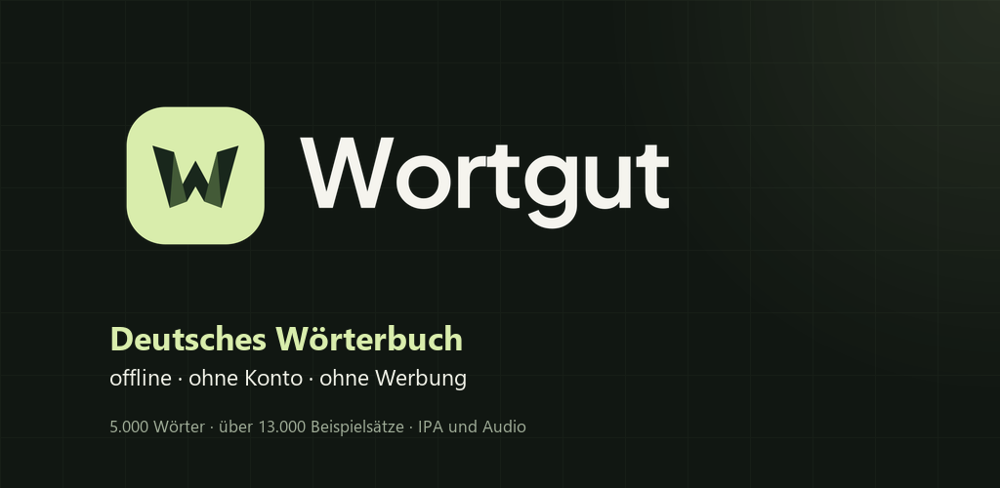

> **Status: beta.** Content review is ongoing. Level labels are uncalibrated frequency estimates (`≈`), not official CEFR levels. This is not an official or public release.

## What it is

Wortgut is a single-volume German dictionary with 5,000 headwords, grammar and pronunciation, plus a learning layer: spaced-repetition flashcards, exercises, a guided A1–B2 course, exam preparation, short reading texts, and an optional AI conversation coach. The dictionary and learning data work offline; audio is streamed from Wikimedia on demand.

## Highlights

- **5,000 dictionary entries** with meanings, word classes, gender, plural, declension, conjugation, IPA, hyphenation, synonyms and frequency rank
- **13,317 example sentences**, **6,320 verified pronunciation recordings**, and word-of-the-day on the home screen
- **Search** that understands umlauts, inflected forms and compounds
- **Spaced repetition** (SM-2) on your own favourites, with daily goals and progress stats
- **Guided course** from A1 to B2 with placement test, daily plan and unit progress
- **51 sentence-order puzzles**, 18 annotated Kasus examples, 14 exam topics, 12 role-plays, 12 writing tasks and 5 reading texts with comprehension questions
- **Offline PWA** with a trimmed service-worker cache; dark mode; reduced-motion setting; keyboard and screen-reader friendly
- **Privacy by default**: no tracking, no ads, no account needed for the dictionary; optional web accounts are only used for the Plus tier
- **AI coach is optional** and runs against a user-configured endpoint/key — no text is sent anywhere unless you set it up

## Screenshots

### Web app

| | | |
| --- | --- | --- |
| 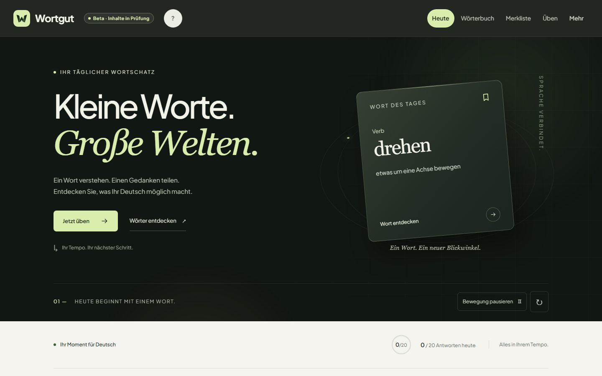 | 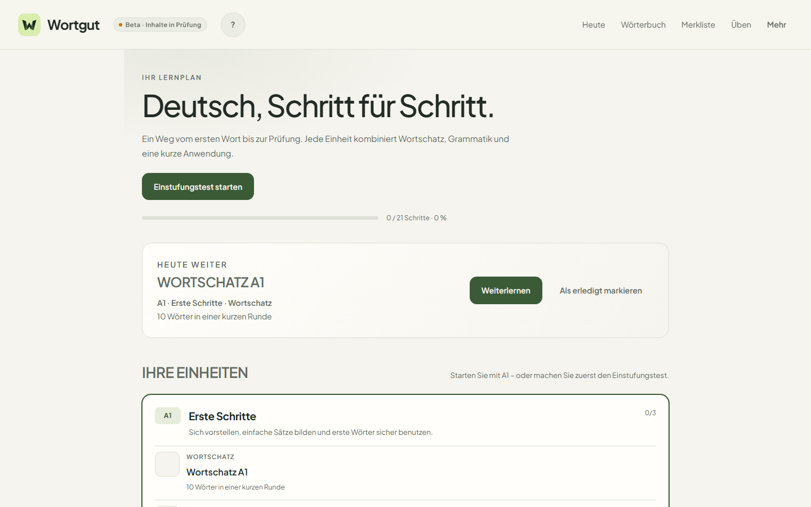 | 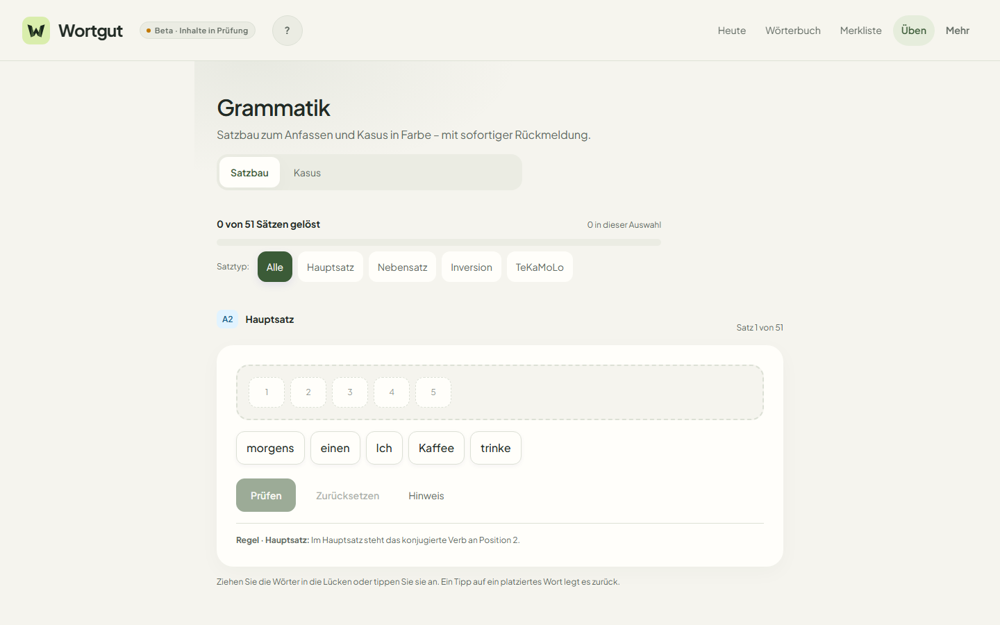 |
| Home / word of the day | Guided course | Grammar & word-order puzzles |

| | |
| --- | --- |
| 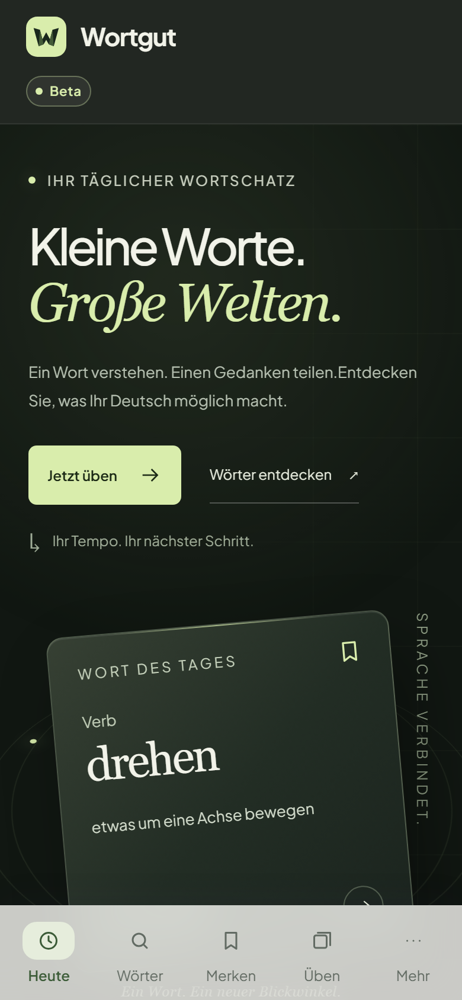 | 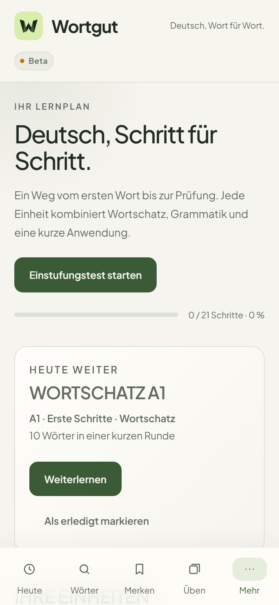 |
| Mobile home | Course on mobile |

### Android app

| | | |
| --- | --- | --- |
| 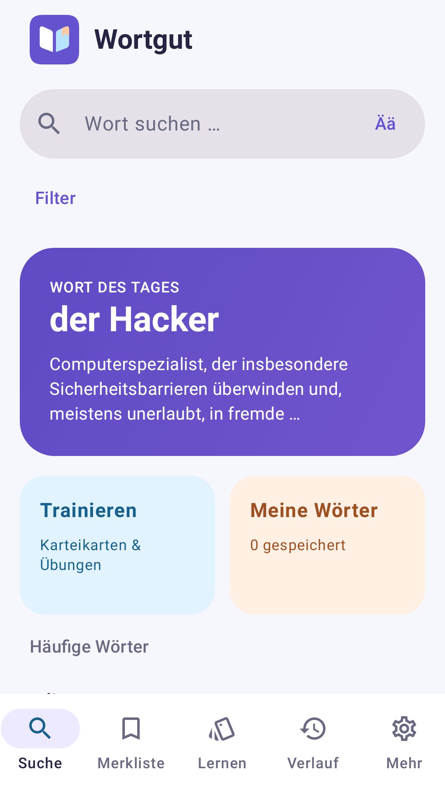 | 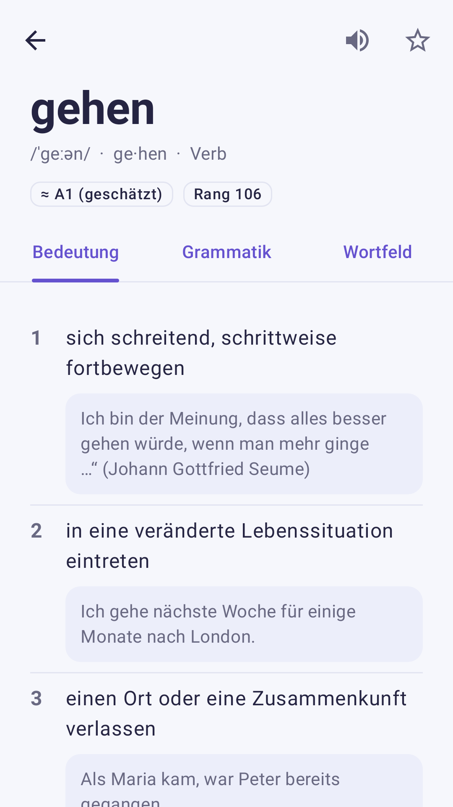 | 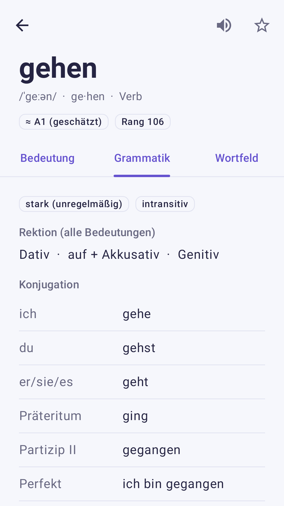 |
| Start & word of the day | Dictionary entry | Grammar and conjugation |

| | | |
| --- | --- | --- |
| 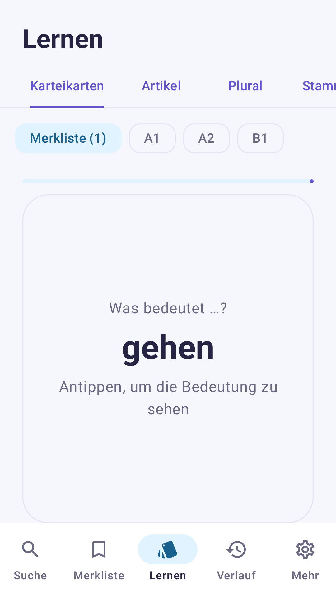 | 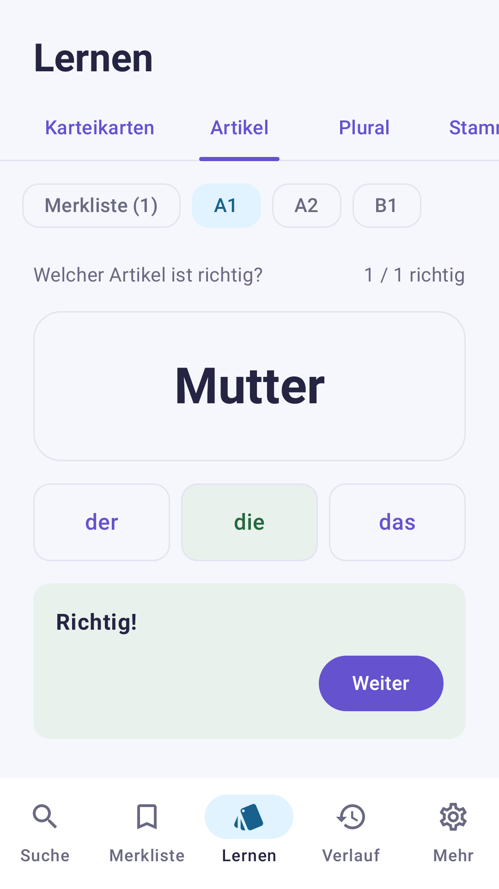 | 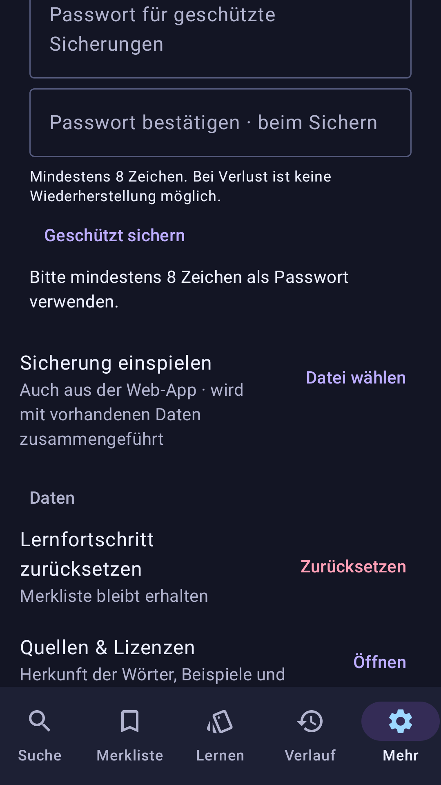 |
| Flashcards | Exercises with feedback | Sources and licences |

The Android screenshots are Compose renders from the current source (Roborazzi/JVM); the Play-store build and physical-device test are still pending.

## Under the hood

- **Web**: React 19 + TypeScript, esbuild, a hand-written service worker and design system; installable PWA
- **Android**: Kotlin + Jetpack Compose, DataStore, offline dictionary assets, word-of-the-day widget
- **Data**: Python pipeline that builds and audits the dictionary, generates attribution sidecars, pins source revisions and runs release-evidence gates
- **Hosting**: Vercel for the web app; optional Supabase auth and Stripe billing for the web Plus tier
- **Quality**: unit tests across web, pipeline and Android; provenance matching against pinned Wiktionary revisions (12,920 of 12,961 examples matched); private offline review workspace; release builds gated on documented evidence

## Content, licensing and status

The dictionary is built from openly licensed sources:

| Source | Content | Licence |
| --- | --- | --- |
| [German Wiktionary](https://de.wiktionary.org/) | definitions, examples, grammar | CC BY-SA 4.0 |
| [Wikipedia](https://de.wikipedia.org/) | recovered example sentences (article revisions) | CC BY-SA 4.0 |
| [Tatoeba](https://tatoeba.org/) | example sentences (sentence pages with author) | CC BY 2.0 FR |
| [Wikimedia Commons](https://commons.wikimedia.org/) | audio recordings (per-file licences) | per file (mostly CC BY-SA / CC0) |
| [FrequencyWords](https://github.com/hermitdave/FrequencyWords) | frequency ranks | CC BY-SA 4.0 |

Attribution for every entry, example and recording is shown in the app under **Quellen & Lizenzen** ([open it](https://wortgut.vercel.app/sources.html)). AI-generated examples and edits are labelled in the entries. The release gate (29,644 review units covering semantics, provenance, audio and level policy) is **not yet complete** — that is why the app is beta.

See [ATTRIBUTION.md](ATTRIBUTION.md) for details.

## Repository scope

This repository is a **showcase**: screenshots, presentation assets and documentation. The product source code is private. The images show dictionary content from the sources above and remain subject to their licences.

## Author

[Hossein Rahimi](https://github.com/HoosseinRahimi)
